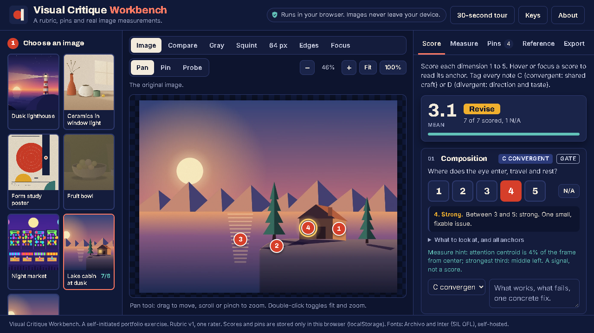

# Visual Evaluation Rubric and Critiques (Concept)

**▶ [Try the live tool](https://critique.lbishop.app)**  ·  critique.lbishop.app

A self-initiated exercise in structured visual critique: an eight-dimension rubric (1-5 scale, convergent vs divergent taste) applied to six practice images drawn in code. The samples are not AI-generated and are not an evaluation of any vendor's output.

- [Rubric](rubric.md)
- [Critiques](critiques.md)
- [Case study](case-study.md)

## Try the live tool

A working version of the rubric you can use on any image. Score it, pin notes to it, and check your eye against real measurements.

- **Score against an 8-dimension rubric**, 1 to 5, with the anchor text on hover. A convergent dimension scored 1 caps the verdict at Revise, live.
- **Tag every note C or D**: convergent craft that reviewers should agree on, or divergent taste that depends on direction.
- **Drop numbered pins** on the image, with a note and a tag each.
- **See what the image does with detail stripped away**: grayscale, squint at three blur levels, a 64 px thumbnail, edges, and a focus map.
- **Measure, don't guess**: luminance histogram, dominant palette with a palette-control score, a two-point contrast probe, and a focal-peak count. Plain image processing, no ML models.
- **Compare with my critiques**: seven constructed practice samples, each with my written critique to reveal after you score.
- **Export** as Markdown, JSON or a PNG one-pager. Sessions save in your browser only.
- **Private by construction**: your image is decoded and measured in the page, never uploaded, and a Content-Security-Policy blocks network requests.

[Open the live tool](https://critique.lbishop.app)

*A self-initiated exercise. One rater's rubric, version 1. It does not evaluate any vendor's output and does not replace human judgment.*

© 2026 lbishopdev. All rights reserved. View only; see [LICENSE](LICENSE).
