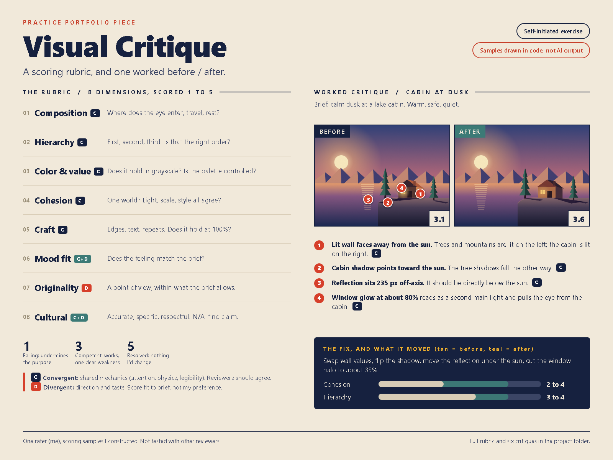

# Case study: building a visual critique rubric and testing it on constructed samples

**Type:** Self-initiated exercise. No client, no brief from anyone else, no outside review.
**Role:** Everything: rubric, sample images, scoring, write-up.
**Files:** `rubric.md`, `critiques.md`, `summary-thumbnail.png`, `samples/`

## The problem

Evaluating visual output is mostly a job of describing what you see in a way someone else can act on. "I don't like it" is not useful. "The cabin's right wall is lit but the sun is on the left" is useful. I wanted to practice the second kind of sentence, and to show how I write it.

I also wanted to work on a harder problem inside evaluation: telling apart two kinds of judgment.

- Fundamentals that most trained reviewers would agree on (does the light make sense, does the eye know where to go).
- Direction and taste that reasonable reviewers will split on (flat vs. painterly, restrained vs. maximal, what counts as original).

If those get mixed together, a critique either bullies a style choice with false objectivity, or waves through a real error as "just taste".

## Approach

**1. A rubric I could actually use.** I wrote eight dimensions (composition, hierarchy, color and value, cohesion, craft, mood fit, originality, cultural relevance), each with anchors for 1, 3 and 5, a short question, and quick checks (the 3-second glance, squint, grayscale, light audit). Each dimension is marked convergent `[C]`, divergent `[D]`, or mixed. There is also an N/A rule and a gate: a `[C]` dimension at 1 caps the verdict, so one broken fundamental is not averaged away.

**2. Samples I could fully control.** I drew six images in code (SVG, rendered to PNG with headless Edge). Three were built to be strong in different styles: flat-vector poster, warm minimal still life, geometric poster. Three were built to be plausible but flawed: muddy palette, crowded hierarchy, inconsistent lighting logic. They are labeled as practice samples throughout. I did not use or evaluate any real model output, and I am not claiming these are AI-generated.

**3. Written critiques in a fixed shape.** For each sample: a made-up brief, scores, what works, what fails, a concrete fix, and a convergent-vs-divergent note. I tried to keep each problem specific and checkable ("the ring radius is 200 and the column edge is at 200, so they touch") instead of general ("composition feels off").

**4. A before/after.** For the lighting-logic sample I applied my own fix list and re-scored it. Cohesion went from 2 to 4 and the mean from 3.1 to 3.6. I left the remaining weaknesses (hard shadows, duplicated trees) unfixed and wrote them down.

## What I learned

- **Writing the fix forces a better diagnosis.** When I had to name a testable change for each problem ("move the reflection to directly under the sun"), a few vague complaints turned out to be two or three distinct issues. It also made me drop one that I couldn't turn into a fix.
- **Even strong images have findings.** I built the "strong" samples on purpose and still found problems when I looked closely: a tangent in the poster, an orphaned accent in the still life, an unlit cliff in the lighthouse. I only found them because I looked at edges and light logic on purpose, not just overall impression.
- **The convergent/divergent split is mostly a question about the fix.** If the same fix works whatever the artist's direction, it is convergent. If the fix depends on direction, it is divergent. This was the most useful test I ended up with.
- **"Muddy" and "moody" are different.** A low-key image keeps a clear value pattern with a few bright notes. The muddy sample has none, so it is a convergent failure, not a style choice.
- **Convergent scoring alone would push toward a polished, safe average.** If I were helping set standards for a larger set of images, I would use the convergent scores as gates and keep the divergent ones as tags and distributions, so valid variety does not get scored away.

## Limits (being straight about them)

- **One rater, and I made the samples.** I knew the flaws in advance, so this shows my method, not how well my judgment holds up on unknown images. The scores have not been checked against another reviewer, and I have not measured agreement.
- **The samples are simple.** They are flat vector scenes. They do not test the things real generated imagery is often judged on, such as photorealism, human figures and hands, text rendering, or fine texture. My rubric includes a craft dimension for those, but I have not exercised it here.
- **The cultural dimension is barely tested.** Only the geometric poster got a score there. A real test needs a brief with a specific cultural context and someone with knowledge of it.
- **The rubric is version 1.** The anchors and verdict bands are my judgment. I have not calibrated them against other people's scores.
- **Originality scores are low across the board.** The samples were deliberately conventional, and originality is a divergent call, so I treat those numbers as soft.

## Next steps I would take

1. Have two or three other reviewers score the same six images blind, then look at where they differ by 2 or more points. Fix ambiguous anchors, and re-tag true taste splits as divergent.
2. Add samples with figures, text and photographic styles.
3. Write two or three pinned example images per score level as anchor sets.
